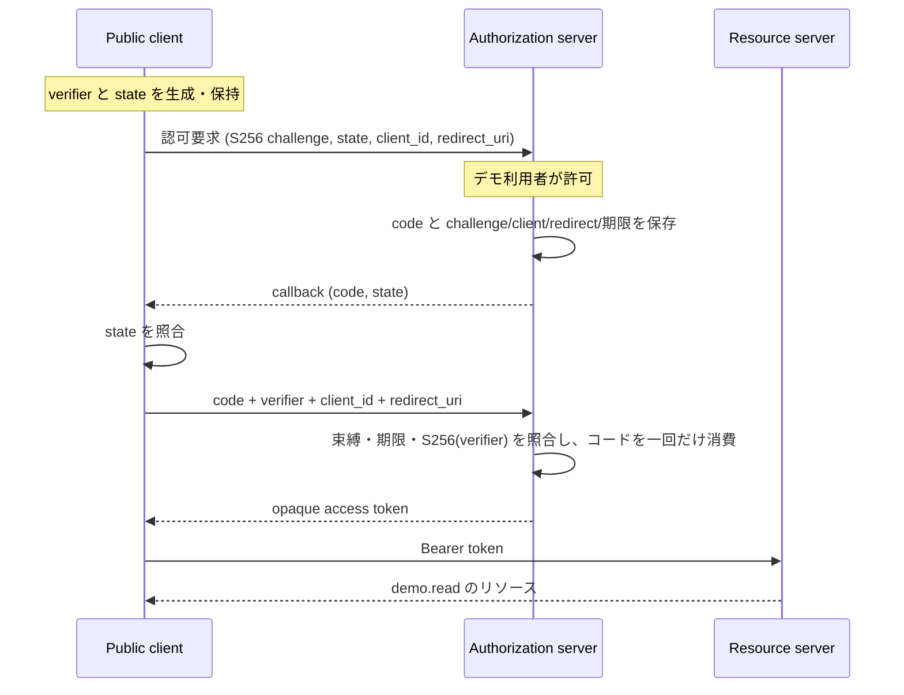

# Authorization Code + PKCE のサンプル

## 閲覧ページ

- `/samples/`: サンプル一覧
- `/samples/pkce/`: ブラウザ内でフローを体験
- `/samples/pkce/code.html`: 公開版と一致する共通ロジック・Workers・クライアントのコード

仕様カタログから challenge 計算フォームを移し、認可コード発行からトークン交換までを独立ページにまとめています。

## PKCE をどこに組み込むか



RFC 7636 §4.3–4.4 の認可要求・コード発行時の束縛と、§4.5–4.6 のコード交換時の照合を一続きで扱います。認可コードグラントは RFC 6749 §4.1、コードの再利用禁止は §4.1.2 を参照します。

`state` はクライアントが callback の要求対応を確認する値です。PKCE の verifier と別に生成し、state 不一致なら token 要求を送りません。PKCE は利用者認証や、機密クライアントの認証そのものを代替しません。このサンプルは client secret を持たない固定の公開クライアントです。

## 静的デモの範囲

Pages は1つのブラウザ内で3つの役割をシミュレーションします。MemoryStore と Web Crypto を使い、プロトコル要求をネットワークへ送りません。通信境界や実際のログインを提供するものではありません。

順に実行すると、challenge を送り、code が発行され、verifier で交換されることを観察できます。別の verifier・state 改ざん・使用済み code の再利用も試せます。デモ用の値だけを扱ってください。

## 実際の HTTP フローを Workers で動かす

Node.js 24以上で、リポジトリのルートから:

```sh
npm ci
npm run dev
```

別ターミナルで:

```sh
node examples/pkce-client.mjs --approve
```

クライアントは verifier/state を生成し、認可要求を送信し、固定デモ利用者としての許可を明示的にPOSTします。callback の Location を手動で受け取って state を検証してから code を交換し、リソースを取得します。`--approve` はこのデモの同意操作を行う指定です。

登録値は `client_id=terastack-demo`、`redirect_uri=https://client.example/callback`、`scope=demo.read` に固定しています。callback ホストは説明用でホストしていないため、CLI は外部へリダイレクトを追いません。ブラウザで `/authorize` を直接開くと同意フォームを表示できますが、許可後の外部 callback を受け取る実クライアントUIはこのサンプルでは提供していません。

| エンドポイント | 動作 |
| --- | --- |
| `GET /authorize` | 登録値・S256 challengeを検証し同意フォームを表示 |
| `POST /consent` | 同一originの許可操作でcode発行、拒否ならerror付きcallback |
| `POST /token` | URLエンコードされた認可コード交換を検証 |
| `GET /resource` | Bearer token・有効期限を確認 |
| `GET /health` | ローカル起動確認 |

旧 `POST /examples/pkce` の計算エンドポイントは廃止しました。

Workers では `PKCEIssuer` Durable Object の SQLite ストレージを使用します。code の検証・削除とtoken保存を同じトランザクションに入れ、並行した交換でも一回だけ成功させます。コード期限は5分、トークンは10分です。alarmで期限切れの記録を削除します。ブラウザのMemoryStoreとサーバーの永続ストレージは区別しています。

Cloudflareへのデプロイはこの変更では実行しません。デプロイ時にはDurable ObjectsのbindingとSQLite migrationが必要で、設定はwrangler.jsoncに含めています。Cloudflare側の利用条件・料金は別途確認してください。

## 検証

```sh
npm test
npm run test:pkce
npm run test:pages
# wrangler dev 起動中
node tests/workerd-smoke.mjs
```

HTTPの正常系、S256以外、verifier/client/redirect不一致、期限切れ、state不一致、重複パラメーター、コード再利用、並行交換を検証します。`workerd-smoke` は実際のSQLite Durable Objectに対して並行交換等を行います。

## 省略したもの

利用者のログイン・セッション・実際の所有者の権限判断は実装しておらず、主体は固定の `demo-user` です。クライアント登録も固定です。トークンはJWTではなくランダムなopaque値です。refresh token、失効エンドポイント、使用済みコード再送時の発行済みトークン失効（RFC 6749 §4.1.2のSHOULD）、本番向けのレート制限・運用監視は含みません。

サンプルの目的はコードとPKCEの束縛を確認することです。実アカウントの認可サーバーとして使わないでください。
