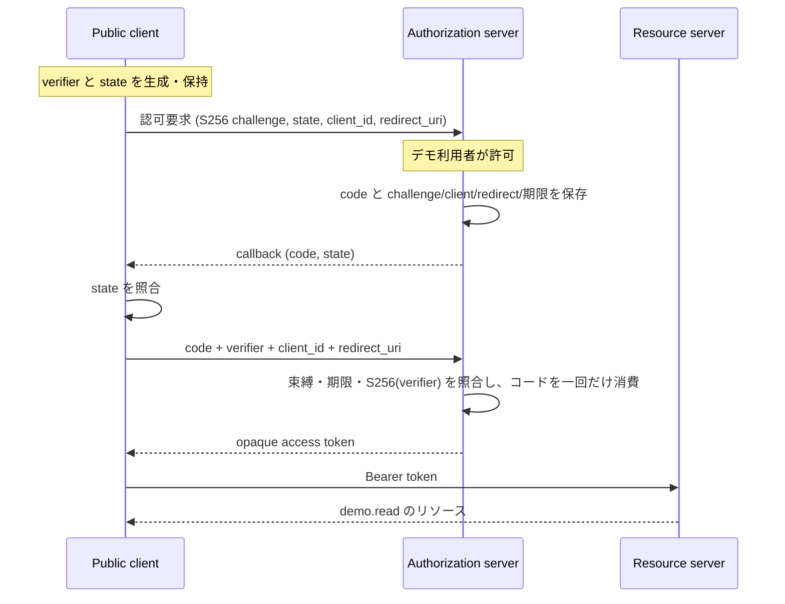

# Authorization Code + PKCE のサンプル

## 閲覧ページ

- `/samples/`: サンプル一覧
- `/samples/pkce/`: ブラウザ内でフローを体験
- `/samples/pkce/code.html`: 公開版と一致するプロトコル・クライアントのコード

仕様カタログから challenge 計算フォームを移し、認可コード発行からトークン交換までを独立ページにまとめています。

## PKCE をどこに組み込むか



RFC 7636 §4.3–4.4 の認可要求・コード発行時の束縛と、§4.5–4.6 のコード交換時の照合を一続きで扱います。認可コードグラントは RFC 6749 §4.1、コードの再利用禁止は §4.1.2 を参照します。

`state` はクライアントが callback の要求対応を確認する値です。PKCE の verifier と別に生成し、state 不一致なら token 要求を送りません。PKCE は利用者認証や、機密クライアントの認証そのものを代替しません。このサンプルは client secret を持たない固定の公開クライアントです。

## 静的デモの範囲

Pages は1つのブラウザ内で3つの役割をシミュレーションします。MemoryStore と Web Crypto を使い、プロトコル要求をネットワークへ送りません。通信境界や実際のログインを提供するものではありません。

順に実行すると、challenge を送り、code が発行され、verifier で交換されることを観察できます。別の verifier・state 改ざん・使用済み code の再利用も試せます。デモ用の値だけを扱ってください。

## ローカルで試す

Node.js 24以上で、リポジトリのルートから:

```sh
npm run build:pages
python3 -m http.server 8000 --directory dist
```

`http://localhost:8000/samples/pkce/` でデモ、`http://localhost:8000/samples/pkce/code.html` でソースを確認できます。

表示される `/authorize`、`/token`、`/resource` はプロトコルの各段階を示すラベルです。実際のHTTPエンドポイントはありません。`https://client.example/callback` は説明用の登録値であり、外部へリダイレクトしません。

`protocol.js` はコードに challenge・client_id・redirect_uri・期限を結び付け、交換時に検証します。MemoryStoreは処理を直列化し、コードの検証・消費とトークン保存をまとめて行います。ページをリセット・再読み込みすると記録は失われます。コード期限は5分、トークンは10分です。

## 検証

```sh
npm test
npm run test:pkce
npm run test:pages
```

コード発行からリソース取得までの正常系、S256以外、verifier/client/redirect不一致、期限切れ、state不一致、コード再利用、並行交換をブラウザ内と同じロジックで検証します。

## 省略したもの

利用者のログイン・セッション・実際の所有者の権限判断は実装しておらず、主体は固定の `demo-user` です。クライアント登録も固定です。トークンはJWTではなくランダムなopaque値です。refresh token、失効エンドポイント、使用済みコード再送時の発行済みトークン失効（RFC 6749 §4.1.2のSHOULD）、本番向けのレート制限・運用監視は含みません。

サンプルの目的はコードとPKCEの束縛を確認することです。実アカウントの認可サーバーとして使わないでください。
